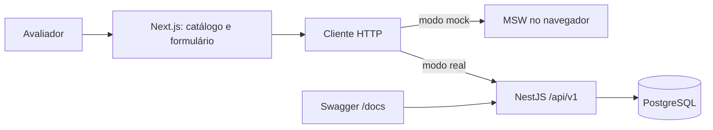
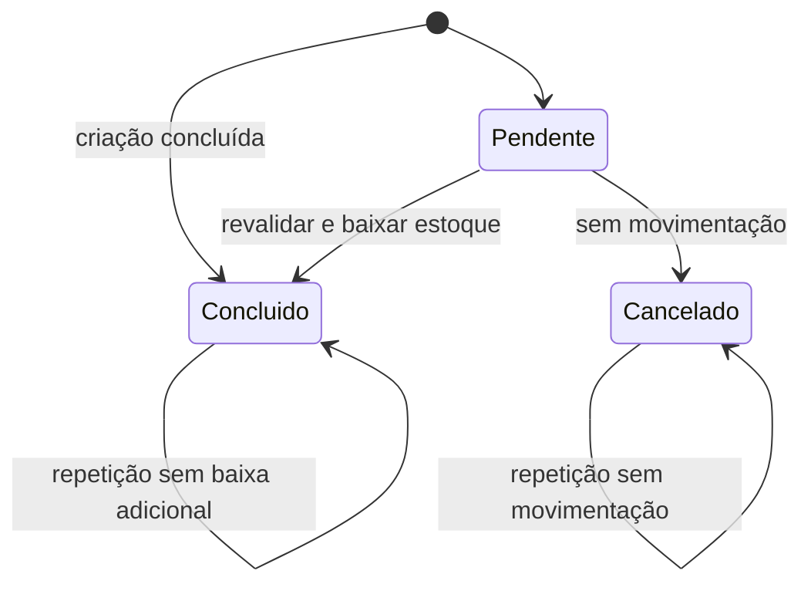

# Arquitetura e decisões de domínio

Este projeto implementa o teste de produtos e pedidos usando o planejamento técnico como base. O teste define os requisitos e os critérios de avaliação; o planejamento detalha escolhas de implementação. Premissas e extras abaixo não são requisitos adicionais atribuídos ao enunciado. As evidências de implementação e os testes estão em [criterios-avaliacao.md](criterios-avaliacao.md).

## Divisão do trabalho

O trabalho é dividido em três pontos focais que se coordenam pelo contrato HTTP e pela integração:

| Ponto focal              | Responsabilidade                                                                                              | Critérios atendidos                                                  |
| ------------------------ | ------------------------------------------------------------------------------------------------------------- | -------------------------------------------------------------------- |
| Frontend                 | Catálogo, formulário, estado global, HTTP mock/real, filtros, ordenação, acessibilidade e testes da interface | Cumprimento, organização, reutilização, testes e extras de interface |
| Backend                  | CRUD, persistência, pedidos, estoque, validação, middleware, Swagger e testes de domínio                      | Cumprimento, SOLID, classes/camadas e testes                         |
| Arquitetura e integração | Contratos, decisões, ambiente, revisão das invariantes e matriz requisito/evidência                           | Organização, qualidade, execução reproduzível e rastreabilidade      |

Os agentes podem solicitar revisão e avisar dependências entre si. A integração tem um responsável único: alterações compartilhadas, ambiente e verificação final passam por ele. Isso evita agentes concorrendo pelos mesmos arquivos ou um ciclo indefinido de reativações. A publicação neste repositório foi autorizada pelo usuário em solicitação posterior; instruções dos PDFs, isoladamente, foram tratadas como conteúdo do teste.

## Componentes

`apps/web` concentra a interface em Next.js, TypeScript e Tailwind. O catálogo usa HTTP nos dois modos, sem duplicar regras de acesso em componentes. TanStack Query mantém dados remotos; parâmetros da URL representam consulta, ordenação e página; Context com reducer mantém estado global da interface e do carrinho. O carrinho é persistido no navegador, enquanto o servidor continua sendo a autoridade sobre preços e estoque. React Hook Form e Zod tratam valores e erros do formulário.

`apps/api` é um monólito modular NestJS com módulos de produtos e pedidos. Controllers traduzem HTTP, DTOs validam entradas, services aplicam regras e portas de repositório isolam persistência. Implementações TypeORM usam PostgreSQL. Regras de estoque ficam exclusivamente na API.

`packages/contracts` contém tipos de transporte compartilhados, sem entidades de banco, decoradores Nest ou acesso à persistência. TypeScript ajuda em desenvolvimento, mas validação de entrada em tempo de execução continua necessária.

## Contrato HTTP

O prefixo das rotas de domínio é `/api/v1`. Atributos de transporte usam português em `snake_case`. `preco_centavos` representa o preço do produto no enunciado; `total_pedido_centavos` representa o total do pedido. Inteiros em centavos evitam arredondamento por ponto flutuante. Datas são ISO 8601 em UTC e identificadores são UUIDs gerados pelo servidor.

| Método e caminho            | Operação                                   |
| --------------------------- | ------------------------------------------ |
| `GET /produtos`             | Filtrar, ordenar e paginar produtos ativos |
| `GET /produtos/:id`         | Buscar produto ativo                       |
| `POST /produtos`            | Criar produto                              |
| `PATCH /produtos/:id`       | Atualizar campos editáveis                 |
| `DELETE /produtos/:id`      | Excluir logicamente produto                |
| `GET /pedidos`              | Listar pedidos com itens, total e status   |
| `GET /pedidos/:id`          | Buscar pedido com itens                    |
| `POST /pedidos`             | Criar pedido pendente ou concluído         |
| `PATCH /pedidos/:id/status` | Concluir ou cancelar pedido pendente       |

Consultas de produtos combinam `nome`, `preco_min_centavos` e `preco_max_centavos`. Limites são inclusivos; mínimo maior que máximo é inválido. A busca por nome é substring sem distinção de maiúsculas. Ordenação usa os campos permitidos `nome`, `preco` e `criado_em`, com direções `asc` e `desc`; IDs desempatarão a ordenação. Filtros são aplicados antes da paginação.

Listagens usam `{ data, meta: { pagina, limite, total, total_paginas } }`. A documentação Swagger é a referência executável das entradas e saídas. Falhas têm código de aplicação, mensagem e identificador da requisição; SQL e stacks não devem ser expostos ao cliente.

## Regras que completam o enunciado

| Lacuna do teste                                         | Decisão                                                                          |
| ------------------------------------------------------- | -------------------------------------------------------------------------------- |
| Categoria não consta entre os campos do formulário      | Acrescentar categoria, pois ela deve aparecer na lista e no modelo da API        |
| Estoque não consta no frontend                          | Campo adicional com padrão zero no formulário; necessário no contrato da API     |
| Backend não especifica imagem                           | Adicionar URL opcional no modelo; o frontend exige URL no cadastro               |
| Preço e moeda não têm representação definida            | BRL em centavos inteiros; apresentação com formatação pt-BR                      |
| Momento de conclusão de pedido não é definido           | POST permite `Pendente` ou `Concluído`; PATCH permite concluir posteriormente    |
| Pedido pendente não define reserva                      | Conferir disponibilidade na criação, sem reservar nem baixar estoque             |
| Produto removido pode estar em pedido histórico         | Exclusão lógica e snapshots de nome/preço em cada item                           |
| Cancelamento e repetição de conclusão não são definidos | Cancelar apenas pendente; repetir o mesmo status não movimenta estoque novamente |

Os status públicos são exatamente `Pendente`, `Concluído` e `Cancelado`. O total é calculado pela API a partir dos preços dos produtos, e os itens mantêm nome, preço unitário e subtotal do momento da criação. Alterar o produto depois não altera o pedido. O cliente não define total nem preços dos itens.

## Consistência de pedidos e estoque

Criação e conclusão usam transação PostgreSQL. Os produtos são bloqueados em ordem estável de UUID antes de validar saldo, capturar preços ou alterar estoque. Todo acesso da operação usa repositórios vinculados ao mesmo `EntityManager` transacional.

Pedido pendente valida o saldo atual sem reservá-lo. Por isso, dois pendentes podem disputar as mesmas unidades e um deles falhar ao concluir. A conclusão bloqueia primeiro o pedido, revalida produtos ativos e disponibilidade, baixa todos os itens e atualiza o status no mesmo commit. Falha de qualquer item desfaz a operação inteira.

No diagrama, `Concluido` representa o valor público `Concluído`. Estados finais não reabrem. Produto removido após a criação impede conclusão do pendente, preservando o histórico. Produtos inexistentes e itens duplicados na criação são rejeitados.

Exemplo de aceite: estoque 5 e duas compras concluídas simultâneas de 4 unidades devem resultar em um sucesso, um conflito e saldo final 1. Testes com mocks ou SQLite não comprovam os locks PostgreSQL; esse cenário exige conexões concorrentes e verificação do banco real.

## Interface e mock

O modo mock inicia MSW antes das consultas e atende pelo mesmo cliente HTTP. Sua base é de demonstração, em memória, e pode voltar ao seed ao recarregar. O modo real usa a API e persiste no PostgreSQL. `NEXT_PUBLIC_API_MODE` e `NEXT_PUBLIC_API_BASE_URL` são públicos e entram no build do Next.js.

Ao cadastrar com sucesso, a interface invalida as consultas, limpa filtros e volta à primeira página ordenada por mais recentes para o novo produto aparecer. Erros preservam os valores preenchidos. Imagens inválidas recebem placeholder local. A interface contempla carregamento, vazio, sem resultados, falha, envio em andamento e feedback de sucesso.

## Limites e evolução

O pedido posterior do usuário acrescentou uma loja com identidade Suzano, categorias, carrinho e checkout demonstrativo. A interface cria pedidos pendentes e mostra o identificador recebido; conclusão e cancelamento continuam disponíveis na API/Swagger. Fontes da marca e alcance da compra estão em [loja-suzano.md](loja-suzano.md). Uma tela administrativa de pedidos não é requisito do frontend.

Paginação, responsividade, documentação, snapshot visual, Swagger e Docker são diferenciais priorizados. JWT é extra opcional; somente deve ser anunciado se implementado e testado. Não há pagamentos, frete, reserva com expiração ou reposição após cancelamento de concluído.

O POST de pedido aceita `Idempotency-Key` opcional. O registro da chave, a impressão do conteúdo e a resposta original são persistidos na mesma transação do pedido. Repetições com a mesma chave e conteúdo retornam o resultado original; conteúdo diferente causa conflito. O carrinho preserva a chave nas tentativas de uma compra após falha incerta e renova quando os itens mudam ou a compra é confirmada. Sem cabeçalho, chamadas distintas criam pedidos distintos. A idempotência de criação complementa a proteção já existente contra dupla conclusão.

Modelos, comandos, paginação e erros de negócio ficam em `apps/api/src/domain`, sem dependências externas. Serviços e portas usam esses tipos; entidades TypeORM implementam os modelos, DTOs validam o transporte e o filtro HTTP traduz os códigos dos erros de domínio em status públicos. A injeção de dependência do Nest continua na composição dos serviços. Metas de latência do planejamento são hipóteses e não resultados medidos.

Decisões resumidas em [ADRs](adrs.md). Instruções executáveis e limitações do ambiente ficam no README raiz.
